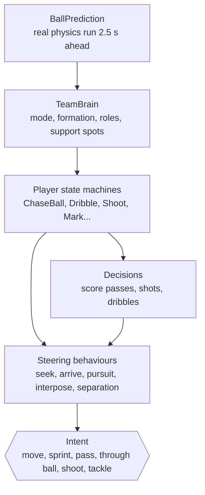
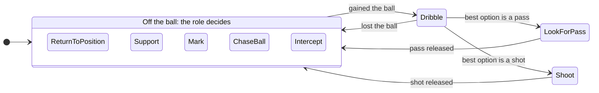
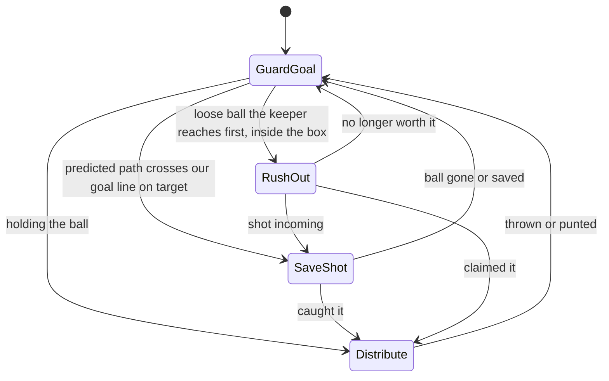

# How the CPU thinks

The CPU opponent is built in layers. Each layer is small enough to read on its own:



The bottom of the stack is the most important fact about the AI: **its only output is
an Intent**, exactly what your keyboard produces. It can't move faster, kick harder or
react instantly, and it never reads your inputs. Code: `src/sim/ai/`. Every AI player is
driven by `AIController.ts`, and your teammates run the same code at Normal difficulty
whenever you're not controlling them.

## Layer 0: seeing the future (BallPrediction)

`sim/ball/BallPrediction.ts` copies the ball into a "ghost" and runs the real
`stepBall()` forward for 2.5 s, recording 75 positions (every 1/30 s). Because it's the
same physics, the prediction includes drag, curve, bounces, rebounds off the boards
and posts. The AI knows a ball played against the boards will come back. Keepers use it
to see where a curling shot will cross the line.

## Layer 1: the team brain

`sim/ai/TeamBrain.ts` looks at the whole pitch once per tick.

### Mode, with reaction time

The raw mode is **attack** (we have the ball or our pass is travelling), **defend** (they
have it) or **loose**. The brain only _acts_ on a new mode after it has persisted for
the preset's `reactionTime`. That's how difficulty creates hesitation: on Easy the team
keeps attacking for half a second after losing the ball. Two things need no thinking
time: the player on the ball plays it, and the player a pass is aimed at goes to meet it.

### Formation in normalised coordinates

Home positions are stored as `[u, v]`. `u` runs from our goal line (-1) to theirs (+1)
and `v` from one touchline (-1) to the other (+1). The same numbers work for both
teams, whichever way they attack.

| Index | Role          | Defend `[u, v]` | Attack `[u, v]` |
| ----- | ------------- | --------------- | --------------- |
| 0     | keeper        | [-0.95, 0]      | [-0.95, 0]      |
| 1     | last defender | [-0.72, 0]      | [-0.32, 0]      |
| 2     | left          | [-0.46, -0.45]  | [0.12, -0.62]   |
| 3     | right         | [-0.46, 0.45]   | [0.12, 0.62]    |
| 4     | striker       | [-0.10, 0]      | [0.55, 0]       |

Each tick the shape slides with the ball: `u += ballU * 0.35`, `v = v * 0.85 + ballV * 0.3`.
When defending, a pressing team also pushes up `(pressIntensity - 0.5) * 0.15`.
Finally it's converted to metres: `x = u * halfLength * attackDir`, `z = v * halfWidth`.

### Roles

| Mode   | Roles handed out                                                                                                                                                                                                                                                                                    |
| ------ | --------------------------------------------------------------------------------------------------------------------------------------------------------------------------------------------------------------------------------------------------------------------------------------------------- |
| attack | **carrier** (on the ball), **receiver** (pass target), **cover** (deepest supporter stays back), **support** (everyone else)                                                                                                                                                                        |
| defend | **presser** (soonest to the ball, kept unless someone is 0.3 s quicker: hysteresis stops two players swapping every tick), a second presser on high intensity when the ball is deep in our half, **markers** (greedily assigned to the attackers closest to our goal), **cover** (deepest leftover) |
| loose  | **chaser** (whoever can intercept the ball's predicted path first)                                                                                                                                                                                                                                  |

### Support spots

Every 0.4 s, each support player scores a 3x3 grid of spots 4 m apart around their home:

```
score = 0.35 * open lane from the ball + 0.30 * space (nearest opponent 1..7 m)
      + 0.20 * forward progress + 0.15 * passing distance close to 11 m
      - 0.25 per other supporter within 4 m
```

That last term spreads supporters out so they offer different passing angles.

## Layer 2: player state machines

Each AI player runs a finite state machine (`sim/ai/StateMachine.ts`): every state has
`enter`, `execute` (returns the next state or `null`) and `exit`. States hold no data;
each player's memory lives in an `AgentMemory` object, so all ten players share the
same state objects.

### Outfield players (`PlayerStates.ts`)



**Switching rules** (applied by `AIController` before each update):

1. While a player has the ball, **Dribble / LookForPass / Shoot are sticky**: the brain
   can't pull them out. A shot being charged is also allowed to finish.
2. Otherwise the role picks the state: presser → **ChaseBall**, chaser/receiver →
   **Intercept**, marker → **Mark**, support/cover → **Support**, anything else →
   **ReturnToPosition**.
3. States may also hand over directly (Dribble → Shoot).

| State            | Behaviour                                                                                                                                                                                                |
| ---------------- | -------------------------------------------------------------------------------------------------------------------------------------------------------------------------------------------------------- |
| ReturnToPosition | `arrive` at the formation home; sprint if more than 9 m away.                                                                                                                                            |
| Support          | `arrive` at the brain's best support spot.                                                                                                                                                               |
| Mark             | Stand 1.6 m from the marked attacker, 70% toward our goal and 30% toward the ball.                                                                                                                       |
| ChaseBall        | `pursuit` of a point just goal-side of the ball. Inside the team's pressing zone, close down and tackle when within `tackleRange` and facing the ball (sometimes a slide). Outside it, jockey 2.2 m off. |
| Intercept        | Run to the brain's predicted interception point (from the ball prediction).                                                                                                                              |
| Dribble          | Every `decisionInterval` seconds, score all options (below). Between decisions, carry the ball in the best dribbling direction, steering away from opponents.                                            |
| LookForPass      | Turn toward the receiver for a moment (0.06 s + 25% of reaction time), then press pass or through ball, aimed with `passError` noise.                                                                    |
| Shoot            | Hold shoot for a power that suits the distance (less if pressured), aim at the chosen spot with `shotError` noise, then release.                                                                         |

### Goalkeeper (`Goalkeeper.ts`)



- **GuardGoal**: stand on the arc between the ball and the centre of the goal. The
  distance off the line is `0.5 + clamp(d * 0.1, 0.2, 1.8) * keeperPositioning`, so the
  keeper comes out further when the ball is far away, narrowing the angle.
- **SaveShot**: on entering, sample a prediction error `gaussian * keeperError` (bigger
  for faster shots) and start a `keeperReaction` timer. After reacting, find where the
  predicted path passes the keeper's position. If there's time to get there on foot,
  run; otherwise **dive** when `timeToArrive <= 0.1 + 0.09 * lateralDistance`.
- **RushOut**: only if the keeper's interception time beats every attacker's by 0.15 s
  and the point is inside the box.
- **Distribute**: wait about a second, score passes (same scoring as outfield players),
  then throw (pass) or punt (through ball).

Whether a dive catches, parries or misses is a **rule**, not AI, so it applies to both
keepers equally (`sim/players/Goalkeeping.ts`): catch if the ball is slower than
`catchMaxSpeed` (19 m/s; 12 m/s when diving) and arrives near the body, otherwise parry.

## Layer 3: steering behaviours

`sim/ai/Steering.ts`, after Craig Reynolds' classic paper. Each returns a desired velocity:

- **seek**: full speed straight at the target.
- **arrive**: like seek, but speed scales down inside a slowing radius, so the player stops
  on the spot instead of overshooting.
- **pursuit**: aim where a moving target will be: `target + velocity * lookAhead`, with
  `lookAhead = distance / closing speed`.
- **interpose**: arrive at a point a fraction of the way between two things (between a
  man and the goal, for example).
- **separation**: push away from nearby teammates (opponents too, when dribbling),
  stronger the closer they are. This stops everyone bunching around the ball.

`toIntent()` converts the summed desired velocity into a move vector (length = fraction
of top speed) and a sprint flag. Asking for more than running pace means sprinting,
exactly the inputs a human gives.

## Layer 4: decisions by scoring options

When the decision timer fires, the carrier scores every option **on the same 0..1
scale**, adds noise, and picks the highest (`decide()` in `PlayerStates.ts`).

### The common currency: position value

`ShotScoring.positionValue(x, z)` = `max(threat, 0.35 * u)`. Near goal it's the
shooting threat of that spot (distance and angle factors with an average keeper);
further out it's how far up the pitch the spot is (`u` from 0 to 1). A real chance
therefore always beats mere territory.

### Scoring a shot (`ShotScoring.evaluateShot`)

```
score = distance * (0.35 + 0.65 * angle) * (0.25 + 0.75 * keeper) * 0.45^blockers
distance = 1 - smoothstep(7 m, 24 m, distance to goal centre)
angle    = clamp(openAngle / 0.45 rad, 0, 1)    openAngle = angle between the two posts
keeper   = smoothstep(0.3 m, 2.0 m, keeper's distance from the shot line)
blockers = outfield opponents within 0.9 m of the shot line
```

Five aim points across the goal are tried and the best is kept, so the AI learns _where_
to shoot as well as _whether_. Multiplying factors means one bad factor (a defender in the
way) sinks the whole shot.

**Worked example** (numbers from the real code). Shooter's ball at (9.4, 1.5), so 10.7 m
from the goal centre, slightly left. Keeper at (18.6, 0.6), one defender at (14, 2.3).

| Factor                          | Calculation                                           | Value     |
| ------------------------------- | ----------------------------------------------------- | --------- |
| distance                        | 1 - smoothstep(7, 24, 10.73) = 1 - 0.123              | 0.877     |
| angle                           | openAngle 0.454 rad ≥ 0.45                            | 1.0       |
| keeper (aim z = -2.0, far post) | keeper 2+ m from that line                            | 1.0       |
| blockers                        | defender at z = 2.3 is nowhere near the far-post line | 0 → ×1    |
| **score**                       | 0.877 × 1.0 × (0.25 + 0.75 × 1.0) × 1                 | **0.877** |

Move the defender to (14, -0.1), across the far-post line: the far-post shot now has a
blocker (×0.45), so the best aim becomes the near post (z = +2.0). The keeper is only
1.3 m from that line (keeper factor 0.659), giving 0.877 × (0.25 + 0.75 × 0.659) =
**0.652**. Still a decent shot, but now a good pass might beat it.

A shot is only considered if it clears the preset's `shootThreshold`.

### Scoring a pass (`PassScoring.scorePass`)

```
score = (1 - risk) * (0.9 * value + 0.1 * space)
risk  = Interception.passLaneRisk: can any defender reach the lane before the ball?
value = positionValue at the target (receiver position + 0.35 s of their movement)
space = smoothstep(1 m, 6 m, nearest opponent to the target)
```

**Lane risk** walks along the pass at 10 points (up to 90% of the way; the last stretch
is the receiver's own space). For each point and each defender it compares:

- when the ball gets there: solve `d = v t - a t²/2` for t (rolling with deceleration a), and
- when the defender gets there: `reaction + (distance - reach) / speed`.

The defender's margin goes through a smooth step, so "just about makes it" counts as
partly risky. Through balls skip the middle of the flight (over everyone's head) but add
a race between the receiver and the nearest defender to the landing spot.

**Worked example.** Carrier on the ball at (0.38, 0). Teammate A at (8, -5), teammate B
at (9, 4). One defender at (4.5, 2.4), close to B's lane.

|           | Pass to A                                                                      | Pass to B                                                          |
| --------- | ------------------------------------------------------------------------------ | ------------------------------------------------------------------ |
| distance  | 9.1 m → launch speed √(5² + 2 × 2.6 × 9.1) × 1.06 = 9.0 m/s                    | 9.5 m                                                              |
| lane risk | defender ~4 m from the lane, can only half-reach the far end in time: **0.28** | defender 0.45 m from the lane, there long before the ball: **1.0** |
| value     | threat at (8, -5) = **0.49**                                                   | threat at (9, 4) = 0.60                                            |
| space     | nearest opponent > 6 m away: 1.0                                               | 0.85                                                               |
| **score** | (1 - 0.28) × (0.9 × 0.49 + 0.1 × 1.0) = **0.39**                               | (1 - 1.0) × ... = **0**                                            |

B is the better _position_, but the pass would be cut out, so the AI plays to A.

### Scoring the dribble

Five directions around "straight at goal" are tried. Each scores the position value 3.5 m
ahead times `(0.55 + 0.45 * room)`, where room measures the space there, and ×0.6 near
the boards. Under pressure (an opponent within 2.5 m), the dribble's score is cut by up
to half, which pushes the carrier to pass.

### Adding personality (noise)

Each option's score gets `gaussian() * decisionNoise` added before comparison. Hard
(0.04) almost always picks the best option; Easy (0.22) often picks the second or third
best.

## Interception maths

**Constant velocity (exact).** A ball at P moving with velocity V, a chaser at Q with top
speed s. We want the earliest t ≥ 0 where `|P + V t - Q| = s t`. Square both sides with
D = P - Q:

```
(|V|² - s²) t² + 2 (D·V) t + |D|² = 0
```

That's a quadratic; take the smallest non-negative root (`interceptTimeConstantVelocity`).
Example: ball from (0,0) at 10 m/s along x, chaser at (10, 5) running 5 m/s:
`75 t² - 200 t + 125 = 0` gives t = 1 or 5/3, so they meet after 1 s at (10, 0),
exactly 5 m from the chaser. Equal speeds make the t² term vanish, so the code solves
the linear equation instead.

**Real balls (sampled).** Friction, bounces and boards rule out a neat formula, so
`findInterception()` walks along the ball prediction and returns the first sample the
player can reach in time:
`distance(sample, player) - reach <= speed * (t - reaction)`.
The team brain uses it to pick chasers, receivers use it to meet passes, and keepers use
it to decide whether to rush out.

## What each difficulty setting changes

All values live in `AI.presets` in `src/config.ts`. None of them touch speed or physics.

| Setting             | What it changes                                                                                                                  | Easy   | Normal | Hard   |
| ------------------- | -------------------------------------------------------------------------------------------------------------------------------- | ------ | ------ | ------ |
| `reactionTime`      | Delay before the team acts on a possession change; also the pause before a new carrier decides, and the turn time before passing | 0.50 s | 0.28 s | 0.14 s |
| `decisionInterval`  | How often the carrier re-evaluates pass/shoot/dribble                                                                            | 0.70 s | 0.40 s | 0.20 s |
| `passError`         | Aim noise on passes (radians); partly absorbed by the sim's aim assist                                                           | 0.22   | 0.12   | 0.05   |
| `shotError`         | Aim noise on shots, as a fraction of the goal half-width                                                                         | 0.45   | 0.25   | 0.13   |
| `decisionNoise`     | Randomness added to option scores: picks worse options                                                                           | 0.22   | 0.12   | 0.04   |
| `pressIntensity`    | Sprinting to press, how far up the pitch the pressing zone starts, defensive line height, a second presser near goal (> 0.75)    | 0.25   | 0.60   | 0.95   |
| `tackleRange`       | How close the presser gets before tackling                                                                                       | 1.00 m | 1.15 m | 1.25 m |
| `slideTackleChance` | Chance a sprinting presser slides                                                                                                | 0.05   | 0.15   | 0.25   |
| `keeperReaction`    | Keeper's delay before reacting to a shot                                                                                         | 0.36 s | 0.24 s | 0.15 s |
| `keeperError`       | Keeper's error reading where the shot crosses the line                                                                           | 0.9 m  | 0.5 m  | 0.25 m |
| `keeperPositioning` | How well the keeper comes off the line to narrow the angle                                                                       | 0.55   | 0.80   | 1.00   |
| `shootThreshold`    | Minimum shot score before shooting                                                                                               | 0.42   | 0.36   | 0.32   |

In headless CPU vs CPU runs (3-minute matches), Hard beat Easy in every one of six
matches, and Normal vs Normal averaged about six shots a side with two or three goals
each. Hard is genuinely hard but beatable: its defenders can still be dragged out of
position, its keeper can't reach a well-placed power shot, and every rule it plays by is
yours too.

## Debugging and tuning the AI

- Open **http://localhost:5173/#debug**. The AI overlay labels every AI player with
  `state / role` and draws a blue line to their target and a yellow line for their
  steering. The lil-gui panel's "AI difficulty presets" folder edits the presets live.
- `tests/simulateMatch.ts` plays a headless CPU vs CPU match in about a second. Write a
  quick test that calls it with different presets and prints the stats, to measure a
  change instead of guessing.
- `AIController.debugInfo()` returns the same data the overlay uses, handy in tests.
