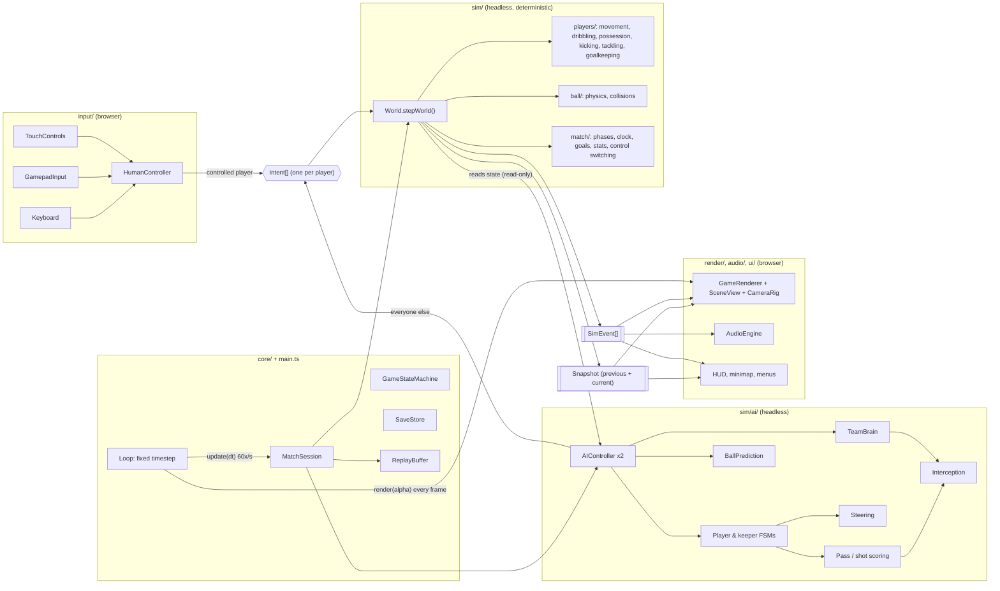
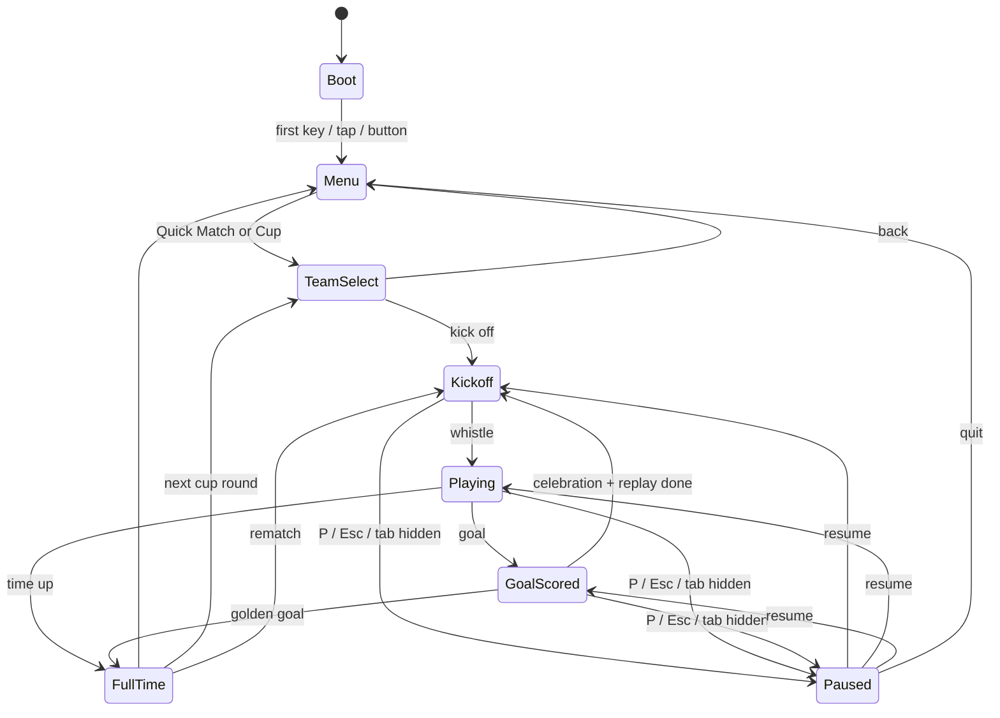

# Architecture

Rebound Five is built around two rules:

1. **The simulation is separate from the rendering.** `src/sim` is headless: plain data,
   no DOM, no Three.js scene graph, no clock, no `Math.random()`. It runs the same in the
   browser and in Node, where the tests play whole matches.
2. **Everyone plays by the same rules.** Every player, human or CPU, is driven by an
   `Intent`. The sim only ever sees Intents.

Everything else follows from those two ideas.

## Module map

Arrows only point **away** from the simulation toward presentation, never back. The AI
reads the world but can only influence it through Intents, exactly like you.

## What lives where

| Folder          | Responsibility                                                                                                                                      | May use the DOM?                               |
| --------------- | --------------------------------------------------------------------------------------------------------------------------------------------------- | ---------------------------------------------- |
| `src/sim/`      | The rules of the game: physics, players, match flow, AI. Plain data in a `World` object.                                                            | **No** (ESLint enforces it)                    |
| `src/core/`     | App plumbing: the loop, the app state machine, storage, seeded RNG, cup logic, `MatchSession` (one match = world + AIs + snapshots), replay buffer. | Only `Loop` (rAF) and `Storage` (localStorage) |
| `src/input/`    | The `Intent` type and the devices that produce Intents.                                                                                             | Yes (except `Intent.ts`)                       |
| `src/render/`   | Three.js: reads snapshots, moves meshes, animates bodies, runs the camera.                                                                          | Yes                                            |
| `src/audio/`    | Web Audio synthesis, driven by sim events.                                                                                                          | Yes                                            |
| `src/ui/`       | HTML HUD, minimap, menus, debug tools.                                                                                                              | Yes                                            |
| `src/config.ts` | Every tuning number, read by all of the above.                                                                                                      | n/a                                            |

The sim may import from `core/SeededRandom.ts`, `config.ts` and the type in
`input/Intent.ts`, all of which are DOM-free. The `no-restricted-imports` rule in
`eslint.config.js` stops it from importing `render/`, `ui/` or `audio/`.

## The life of one tick

A tick advances the simulation by exactly 1/60 s. `core/Loop.ts` calls `update(dt)` as
many times per frame as real time demands (see "the life of one frame").

1. **Input.** `main.ts` calls `HumanController.sample()`. It reads held keys/buttons and
   consumes presses that happened since the last tick (so a quick tap between ticks isn't
   lost), and writes one `Intent`.
2. **`MatchSession.step()`** copies the current snapshot into `previous`.
3. **AI.** Each `AIController.update()` (your team's AI skips the player you control):
   1. `BallPrediction` runs the real ball physics forward 2.5 s on a copy of the ball.
   2. `TeamBrain` updates the team's mode (attack/defend/loose, with a reaction delay),
      the formation's home positions, interception times and roles.
   3. Each player's state machine runs one step and writes that player's `Intent`.
4. **Your Intent** is copied onto the player you control.
5. **`stepWorld()`** (in `sim/World.ts`), during the `playing` phase:
   1. control switching for human teams (Q, follow-the-pass, auto-switch);
   2. timers (actions, cooldowns);
   3. movement: accelerate toward the Intent's desired velocity, turn, clamp to the arena;
   4. separate overlapping bodies;
   5. kickoff protection (opponents out of the centre circle);
   6. keeper holding (the ball follows the hands);
   7. tackles start (keepers dive instead);
   8. kicks: shot charging, passes, through balls, buffered first-time kicks;
   9. dribble touches for the ball carrier;
   10. ball physics in 4 sub-steps (gravity, drag, curve, bounces, boards, posts, nets);
   11. tackle contact, keeper saves;
   12. possession: losing, stealing, trapping, blocking;
   13. stats (possession, shot outcomes);
   14. goal check, then the clock (and full time / golden goal).

   During `kickoff`, `goal` and `fullTime` phases, a reduced, scripted tick runs instead.

6. **Snapshot.** `captureSnapshot()` copies positions, facing, actions and the ball into
   `current`, and the replay buffer records it.
7. **Events.** `main.ts` hands each `SimEvent` (kick, bounce, goal, whistle and so on) to
   the renderer (net ripple, crowd jump), the audio engine and the HUD.
8. **State sync.** If the sim's match phase changed, the `GameStateMachine` follows
   (`kickoff`, `playing`, `goalScored`, `fullTime`).

## The life of one rendered frame

1. The browser calls our `requestAnimationFrame` callback with a timestamp, usually in
   step with the display's refresh (60, 120, 144 Hz...).
2. `Loop` adds the elapsed time (capped at 0.25 s) to the **accumulator** and runs as many
   fixed ticks as fit. The remainder becomes **alpha** (0..1).
3. `render(alpha, frameDt)`:
   1. poll the gamepad (gamepads have no events, so you poll them);
   2. `GameRenderer.render(previous, current, alpha)`:
      - `SceneView.sync()` places every player and the ball at
        `previous + (current - previous) * alpha` (angles via the shortest turn) and
        poses each body (run cycle, kick, slide, dive, celebration);
      - `CameraRig.update()` moves the camera toward its target with frame-rate-independent
        smoothing;
      - the stadium updates net ripples and crowd uniforms;
      - `WebGLRenderer.render()` issues the draw calls; the GPU does the rest;
   3. the audio engine eases the crowd volume toward the ball's distance from goal;
   4. the HUD updates text only when it changed, the minimap redraws on its 2D canvas;
   5. in `#debug`: the FPS meter and AI overlay update.

During an instant replay, step 2 doesn't advance the match. Instead, the replay player
walks through the recorded snapshots and the renderer interpolates between them in
exactly the same way.

## App states

`Paused` remembers which state to resume to. Illegal transitions are refused
(`GameStateMachine.transition()` returns `false`), which makes flow bugs visible.

## Determinism

Given the same seed and the same Intents, a match plays out identically. That holds
because:

- the sim advances in fixed ticks, so the maths is identical however fast your PC is;
- every random choice (tackle success, shot error, AI decision noise) uses `SeededRandom`;
  the AI has its own seeded generator, so it doesn't disturb the sim's sequence;
- the order of operations inside a tick is fixed (players are always processed in id
  order);
- nothing in the sim reads the clock.

`tests/headlessMatch.test.ts` plays the same seeded CPU vs CPU match twice and checks the
results are identical. It's a cheap way to catch accidental non-determinism.

## Where to make common changes

| I want to...                                     | Look in                                                          |
| ------------------------------------------------ | ---------------------------------------------------------------- |
| tune physics, speeds, AI difficulty, colours     | `src/config.ts` (live with `#debug`)                             |
| change a game rule (tackles, keepers, kicks)     | `src/sim/players/*`                                              |
| change match flow (kickoffs, clock, golden goal) | `src/sim/match/Match.ts`, `Clock.ts`                             |
| change how the CPU behaves                       | `src/sim/ai/*` (see [AI.md](AI.md))                              |
| add a new control                                | `src/input/Intent.ts`, `HumanController.ts`, then the sim        |
| change how things look                           | `src/render/*`                                                   |
| add a screen                                     | `src/ui/Menus.ts`, `src/core/GameStateMachine.ts`, `src/main.ts` |
